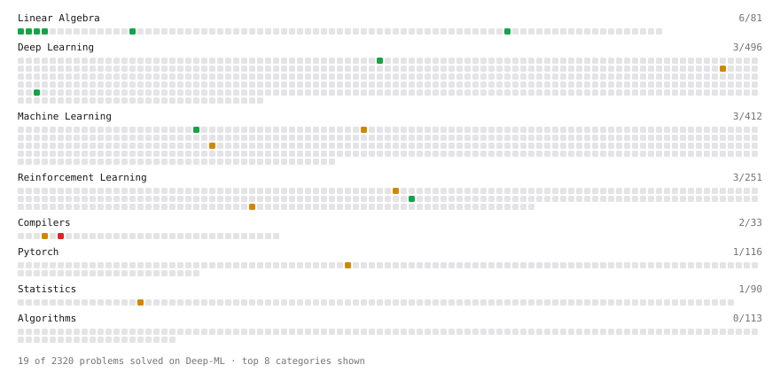

# Deep-ML

My machine learning practice from [Deep-ML](https://www.deep-ml.com). Every solution here was written by hand.

**20** solved · 20 problems · 0 labs · 0 math

[**Browse the interactive portfolio**](https://madhu2007-offical.github.io/deep-ml-solutions/) to replay this filling in over time.

## Problems

| | Difficulty | Solved | |
| --- | --- | --- | --- |
| [Calculate Mean by Row or Column](https://www.deep-ml.com/problems/4) | easy | 2026-11-02 | [solution](problems/0004-calculate-mean-by-row-or-column) |
| [Convert Vector to Diagonal Matrix](https://www.deep-ml.com/problems/35) | easy | 2026-11-18 | [solution](problems/0035-convert-vector-to-diagonal-matrix) |
| [Implement F-Score Calculation for Binary Classification](https://www.deep-ml.com/problems/61) | easy | 2026-11-06 | [solution](problems/0061-implement-f-score-calculation-for-binary-classification) |
| [Loss-of-Plasticity Diagnostics: Dormant Units and Effective Rank](https://www.deep-ml.com/problems/1595) | easy | 2026-11-05 | [solution](problems/1595-loss-of-plasticity-diagnostics-dormant-units-and-effective-rank) |
| [Matrix-Vector Dot Product](https://www.deep-ml.com/problems/1) | easy | 2026-11-02 | [solution](problems/0001-matrix-vector-dot-product) |
| [Nesterov Accelerated Gradient Optimizer](https://www.deep-ml.com/problems/150) | easy | 2026-11-17 | [solution](problems/0150-nesterov-accelerated-gradient-optimizer) |
| [Reshape Matrix](https://www.deep-ml.com/problems/3) | easy | 2026-11-02 | [solution](problems/0003-reshape-matrix) |
| [Step-Size Selection for Tile Coding](https://www.deep-ml.com/problems/608) | easy | 2026-11-12 | [solution](problems/0608-step-size-selection-for-tile-coding) |
| [Tensor Puzzle: Circular Roll by One](https://www.deep-ml.com/problems/1277) | easy | 2026-11-13 | [solution](problems/1277-tensor-puzzle-circular-roll-by-one) |
| [Transpose of a Matrix](https://www.deep-ml.com/problems/2) | easy | 2026-11-02 | [solution](problems/0002-transpose-of-a-matrix) |
| [Algebraic Simplification with Canonical Forms](https://www.deep-ml.com/problems/1511) | medium | 2026-11-07 | [solution](problems/1511-algebraic-simplification-with-canonical-forms) |
| [Bernoulli Naive Bayes Classifier](https://www.deep-ml.com/problems/140) | medium | 2026-11-09 | [solution](problems/0140-bernoulli-naive-bayes-classifier) |
| [Binary Cross-Entropy from Logits](https://www.deep-ml.com/problems/1229) | medium | 2026-11-10 | [solution](problems/1229-binary-cross-entropy-from-logits) |
| [Image Segmentation via K-Means Clustering](https://www.deep-ml.com/problems/832) | medium | 2026-11-04 | [solution](problems/0832-image-segmentation-via-k-means-clustering) |
| [Log-Probability Ratio for Token Sequences](https://www.deep-ml.com/problems/489) | medium | 2026-11-02 | [solution](problems/0489-log-probability-ratio-for-token-sequences) |
| [Memory Complexity: Full Space-Time vs. ST-Factorized Attention](https://www.deep-ml.com/problems/725) | medium | 2026-11-11 | [solution](problems/0725-memory-complexity-full-space-time-vs-st-factorized-attention) |
| [Order-n Polynomial Basis for Value Prediction](https://www.deep-ml.com/problems/1690) | medium | 2026-11-16 | [solution](problems/1690-order-n-polynomial-basis-for-value-prediction) |
| [Pooled Mean and Pooled Standard Deviation from Summary Stats](https://www.deep-ml.com/problems/1244) | medium | 2026-11-15 | [solution](problems/1244-pooled-mean-and-pooled-standard-deviation-from-summary-stats) |
| [Random Sample Greedy Search](https://www.deep-ml.com/problems/638) | medium | 2026-11-19 | [solution](problems/0638-random-sample-greedy-search) |
| [Floor-Division and Modulo Folding for Index Math](https://www.deep-ml.com/problems/1513) | hard | 2026-11-14 | [solution](problems/1513-floor-division-and-modulo-folding-for-index-math) |

---

_This file is regenerated by Deep-ML on every push._
